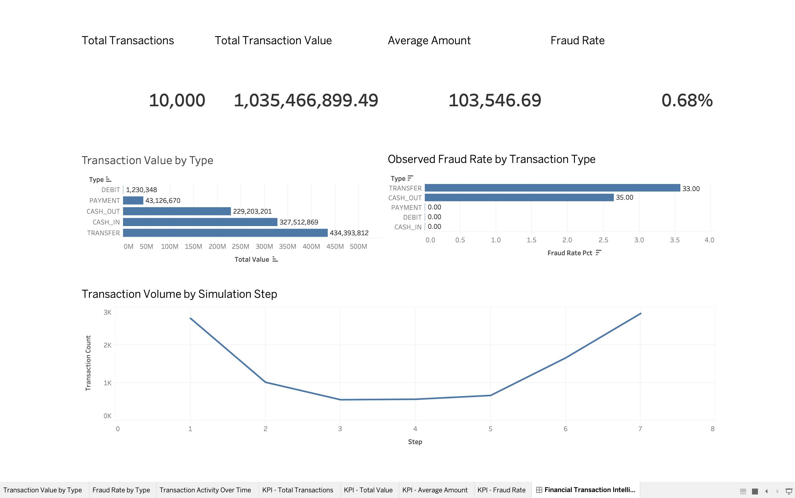

# Financial Services Intelligence

**A data analytics project exploring financial transactions, transaction patterns, and potential fraud indicators using Python, PostgreSQL, SQL, and Tableau.**

## Project Overview

Financial institutions process large volumes of transactions and need effective ways to understand transaction behaviour and identify potential fraud patterns.

This project analyses synthetic mobile-money transaction data to uncover transaction trends, compare transaction types, examine observed fraud rates, and present key findings through an interactive dashboard.

## Business Objectives

- Analyse transaction volumes, values, and average transaction amounts.
- Identify transaction types with higher observed fraud rates.
- Examine how transaction activity and fraud vary across simulation steps.
- Validate data quality before performing analysis.
- Present key performance indicators and analytical findings in a dashboard.

## Technology Stack

| Technology | Purpose |
|---|---|
| Python | Data processing and preparation |
| Pandas | Data cleaning, transformation, and analysis |
| PostgreSQL | Relational database storage |
| SQL | Business analytics and data quality checks |
| Tableau Public | Dashboard visualisation |
| Jupyter Notebook | Exploratory analysis and documentation |
| Git & GitHub | Version control and project documentation |

## Project Workflow

1. **Data ingestion:** Load the PaySim synthetic mobile-money transaction dataset.
2. **Data preparation:** Use Python and Pandas to inspect, validate, and prepare transaction records.
3. **Database storage:** Load the prepared transactions into PostgreSQL.
4. **SQL analytics:** Calculate key performance indicators, analyse transaction types, investigate fraud patterns, and validate data quality.
5. **Visualisation:** Export analytical summaries for Tableau Public and build a dashboard containing KPI cards and charts.
6. **Reporting:** Document the findings and make the project accessible through GitHub.

## Dashboard Preview



**Interactive dashboard:** [View on Tableau Public](ADD_YOUR_TABLEAU_PUBLIC_URL_HERE)

## Key Findings

The current analysis uses a sample of **10,000 transactions**.

- **10,000** transactions analysed.
- **1.035 billion** in total transaction value, in the dataset's monetary units.
- **103,546.69** average transaction amount.
- **68** transactions labelled as fraudulent.
- **0.68%** observed fraud rate.

### Fraud by Transaction Type

- **TRANSFER:** 33 fraud-labelled transactions; observed fraud rate of 3.58%.
- **CASH_OUT:** 35 fraud-labelled transactions; observed fraud rate of 2.65%.
- **CASH_IN, PAYMENT, and DEBIT:** No fraud-labelled transactions in this sample.

These findings describe the selected sample and do not establish that a transaction is fraudulent based on its type alone.

## Data Quality Checks

The SQL analysis includes checks for:

- Missing values in key fields.
- Negative transaction amounts.
- Invalid fraud and flagged-fraud labels.
- Duplicate transaction rows.

The current sample contains no missing values in the checked fields, no negative transaction amounts, no invalid labels, and no extra identical rows.

## Project Structure

```text
financial-services-intelligence/
├── data/
│   ├── raw/
│   └── processed/
├── notebooks/
│   └── financial_transaction_analysis.ipynb
├── sql/
│   └── analytics.sql
├── tableau/
│   ├── dashboard_preview.png
│   └── financial_transaction_intelligence.twbx
├── .gitignore
└── README.md
```

## Dataset

**PaySim — Synthetic Mobile Money Transactions**

Source: [PaySim dataset on Kaggle](https://www.kaggle.com/datasets/ealaxi/paysim1)

PaySim is a synthetic dataset designed to simulate mobile-money transactions. The current project analysis uses a 10,000-row sample rather than the complete dataset.

## Limitations and Future Improvements

- The dataset is synthetic and may not represent real-world financial activity.
- The current results are based on a sample and may not reflect patterns across the full dataset.
- Transaction types and observed fraud rates are exploratory indicators, not definitive fraud detection rules.
- Future improvements could include a larger-scale analysis, additional fraud-pattern investigations, and machine-learning models to compare fraud classification performance.

## Author

**Soham Khopkar**

MSc Computing (Data Analytics) — Dublin City University

[GitHub Profile](https://github.com/Sohamm31)

